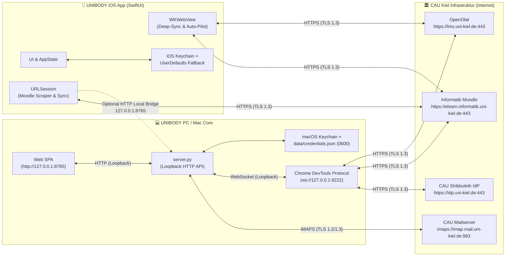

# 🛡️ UNIBODY Network & Security Audit Report (Web/PC & iOS)

**Datum:** 06.11.2026  
**Geprüfte Komponenten:**
- **PC / Web-Core (Python & JS):** `server.py`, `lms_bot.py`, `cau_mail.py`, `cau_materials.py`, `optimizer.py`, `static/app.js`, `static/index.html`
- **Native iOS-App (SwiftUI & WebKit):** `ios/UNIBODY/UNIBODY/` (`Info.plist`, `AppState.swift`, `KeychainHelper.swift`, `LiveDeepSyncSheet.swift`, `LiveAutomationSheet.swift`, `LMSMobileEngine.swift`, `CourseMaterialsService.swift`, `CAUMailService.swift`, `CAUOnlineAccountFetcher.swift`, `SyncService.swift`)

---

## 1. Executive Summary

Die Architektur von **UNIBODY** verzichtet bewusst auf externe Cloud- oder Telemetrie-Server: Alle Zugangsdaten, Sitzungscookies, E-Mails und PDFs werden ausschließlich lokal zwischen dem Endgerät des Studierenden und den offiziellen Servern der **CAU Kiel** (`lms.uni-kiel.de`, `elearn.informatik.uni-kiel.de`, `idp.uni-kiel.de`, `imap.mail.uni-kiel.de`) übertragen.

Aus dem vorangegangenen Code-Audit sind bereits zentrale Schutzmechanismen aktiv (Loopback-Bindung `127.0.0.1`, Path-Traversal-Schutz via `os.path.commonpath`, sichere JSON-Serialisierung bei JavaScript-Injektionen, IMAPS über Port `993` mit TLS-Zertifikatsprüfung).  
Durch den neuen **iOS-Port** sowie eine tiefergehende Analyse der **Netzwerk-, TLS-, CORS-/CSRF- und WebKit-Schnittstellen** wurden **5 neue Befunde (1× Hoch, 3× Mittel, 1× Niedrig)** identifiziert, die im Folgenden samt konkreter Behebung dokumentiert sind.

| ID | Einstufung | Komponente | Titel / Schwachstelle | Status |
| :--- | :--- | :--- | :--- | :--- |
| **NET-01** | 🔴 **Hoch** | iOS (`Info.plist`) | Globales `NSAllowsArbitraryLoads = true` deaktiviert App Transport Security (ATS) für alle Domains statt nur für Localhost (`NSAllowsLocalNetworking`) | ✅ **Gepatcht** |
| **NET-02** | 🟠 **Mittel** | iOS (`LiveDeepSyncSheet`, `LiveAutomationSheet`) | Fehlende Host-/Domain-Allowlist (`*.uni-kiel.de`) vor der Passwort-Injektion in `WKWebView` sowie fehlender `decidePolicyFor`-Navigationsfilter | ✅ **Gepatcht** |
| **NET-03** | 🟠 **Mittel** | iOS (`AppState.swift`) & PC (`lms_bot.py`) | Parallele Klartext-/Base64-Speicherung des Passworts in `UserDefaults` bzw. `credentials.json` selbst bei erfolgreichem Keychain-Write | ✅ **Gepatcht** |
| **NET-04** | 🟠 **Mittel** | PC (`server.py`, `cau_mail.py`) | CSRF-Lücke bei leerem `Origin`/`Referer`-Header (`no-referrer`), fehlendes `Content-Length`-Limit und fehlende Sanitisierung im IMAP-`SEARCH`-Befehl | ✅ **Gepatcht** |
| **NET-05** | 🟡 **Niedrig** | iOS (`LiveDeepSyncSheet`, `SyncService`) | Redundantes `new Function(code)` beim Baum-Menü-Klick und fehlende URL-Schema-/Host-Prüfung beim externen `.ics`-Kalenderimport | ✅ **Gepatcht** |

---

## 2. Netzwerk-Topologie & Datenflüsse



### Überprüfte externe Endpunkte & Protokolle
1. **OpenOlat (`lms.uni-kiel.de:443`):** Ausschließliche Kommunikation über `https://`. Authentifizierung via OpenOlat 21+ FlexiForm AJAX (`/dmz/`).
2. **Informatik Moodle (`elearn.informatik.uni-kiel.de:443`):** Ausschließliche Kommunikation über `https://`. Authentifizierung via `logintoken` + `POST /login/index.php` und `MoodleSession`-Cookie.
3. **CAU Webmail (`imap.mail.uni-kiel.de:993`):** Verschlüsselte `IMAP4_SSL`-Verbindung mit `ssl.create_default_context()` (Zertifikatskette und Hostname werden strikt geprüft).
4. **Lokaler UNIBODY Server (`127.0.0.1:8765`):** Lauscht ausschließlich auf dem Loopback-Interface (`127.0.0.1`), nicht auf `0.0.0.0`.
5. **Lokaler Chrome Debugging Port (`127.0.0.1:9222`):** Durch `--remote-allow-origins=http://127.0.0.1:8765,http://localhost:8765` gegen unautorisierte WebSocket-Zugriffe aus fremden Browser-Tabs abgesichert.

---

## 3. Bereits gehärtete Sicherheitskontrollen (Positiv-Befunde)

- **✅ Strikte Loopback-Isolierung (`server.py:1419`):** `ThreadingHTTPServer(("127.0.0.1", port), ...)` verhindert, dass andere Teilnehmer im selben WLAN (z. B. `eduroam` auf dem CAU-Campus) auf den lokalen UNIBODY-Server zugreifen können.
- **✅ Sichere JavaScript-Literale (`KeychainHelper.swift:64`, `LiveDeepSyncSheet.swift:486`, `lms_bot.py:856`):** Passwörter mit Sonderzeichen (`"`, `'`, `\`, Zeilenumbrüche) werden vor der Übergabe an `evaluateJavaScript` bzw. CDP mittels `JSONSerialization` / `JSONEncoder` / `json.dumps` kodiert, wodurch DOM-basierte Code-Injection ausgeschlossen ist.
- **✅ Path-Traversal-Schutz (`cau_materials.py:258-299`, `CourseMaterialsService.swift:201-207`):** Sowohl auf dem PC (`os.path.realpath` + `os.path.commonpath`) als auch auf iOS (`URL(fileURLWithPath:).lastPathComponent`) werden Dateinamen kanonisiert und auf `.pdf` beschränkt.
- **✅ PDF-Magic-Byte-Prüfung (`cau_materials.py:96`, `CourseMaterialsService.swift:835,861`):** Heruntergeladene Dateien von Moodle oder dem lokalen Server werden nur gespeichert, wenn die ersten 5 Bytes exakt `%PDF-` entsprechen (verhindert das Unterschieben von HTML-Fehlerseiten als PDF).
- **✅ Chrome-Extension mit minimalen Berechtigungen (`lms_bot.py:1164-1217`):** Die generierte Auto-Fill-Extension wird mit `0700`/`0600`-Dateirechten angelegt und besitzt eine strikte `host_permissions`-Allowlist (`lms.uni-kiel.de`, `elearn.informatik.uni-kiel.de`, `idp.uni-kiel.de`, `*.dfn.de`).

---

## 4. Detaillierte Schwachstellen-Analyse & Empfehlungen

---

### 🔴 [NET-01] Globales `NSAllowsArbitraryLoads = true` in iOS `Info.plist` (Hoch)

* **Datei:** `ios/UNIBODY/UNIBODY/Info.plist` (Zeilen 25–29)
* **Kategorie:** Transport Layer Security / iOS App Transport Security (CWE-319)

#### Befund
In `ios/UNIBODY/UNIBODY/Info.plist` ist derzeit folgende Konfiguration eingetragen:
```xml
<key>NSAppTransportSecurity</key>
<dict>
    <key>NSAllowsArbitraryLoads</key>
    <true/>
</dict>
```
Damit wird Apples **App Transport Security (ATS)** für die gesamte App global abgeschaltet. Ursprünglich wurde dies gesetzt, damit die iOS-App im Simulator mit `http://127.0.0.1:8765` kommunizieren kann. Durch `NSAllowsArbitraryLoads = true` würde iOS jedoch auch unverschlüsselte `http://`-Verbindungen ins öffentliche Internet zulassen, falls eine Kurs-URL oder Weiterleitung auf `http://` zeigt.

#### Empfohlene Behebung
`NSAllowsArbitraryLoads` auf `false` setzen (oder entfernen) und stattdessen **`NSAllowsLocalNetworking = true`** verwenden. Dadurch erlaubt iOS unverschlüsseltes HTTP **ausschließlich** für `127.0.0.1` / `localhost` und erzwingt für alle externen Server (`lms.uni-kiel.de`, `elearn.informatik.uni-kiel.de`) zwingend HTTPS mit TLS 1.2/1.3:
```xml
<key>NSAppTransportSecurity</key>
<dict>
    <key>NSAllowsArbitraryLoads</key>
    <false/>
    <key>NSAllowsLocalNetworking</key>
    <true/>
</dict>
```

---

### 🟠 [NET-02] Fehlende Domain-Allowlist in iOS `WKWebView` vor Passwort-Injektion (Mittel)

* **Dateien:**
  - `ios/UNIBODY/UNIBODY/Views/Sync/LiveDeepSyncSheet.swift` (Zeilen 430–594)
  - `ios/UNIBODY/UNIBODY/Views/Courses/LiveAutomationSheet.swift` (Zeilen 253–335)
  - `ios/UNIBODY/UNIBODY/Services/LMSMobileEngine.swift` (Zeilen 36–60, 320–380)
* **Kategorie:** Credential Exposure / WebView Navigation Control (CWE-522 / CWE-601)

#### Befund
Während `lms_bot.py` (Zeile 868) im injizierten Skript explizit prüft:
```javascript
if (!host.includes('uni-kiel.de') && !host.includes('dfn.de')) return 'NOT_CAU';
```
fehlt dieser Host-Guard in den iOS-WebViews (`LiveDeepSyncSheet.swift`, `LiveAutomationSheet.swift`, `LMSMobileEngine.swift`). Sollte ein Kurslink oder eine manipulierte Weiterleitung die `WKWebView` auf eine externe Drittseite außerhalb von `uni-kiel.de` navigieren, die ein `<input name="username">` und `<input type="password">` enthält, würde der Polling-Timer die CAU-Zugangsdaten in diese Seite eintragen. Zudem ist `webView(_:decidePolicyFor:decisionHandler:)` nicht implementiert, um Navigationen auf Nicht-CAU-Domains zu unterbinden.

#### Empfohlene Behebung
1. **In `WKNavigationDelegate` (`decidePolicyFor navigationAction`):** Nur `https`-URLs auf `*.uni-kiel.de` und `*.dfn.de` (sowie `about:blank`) zulassen; alle anderen Hosts mit `.cancel` blockieren.
2. **Vor `evaluateJavaScript` (Swift-seitig & JS-seitig):** Prüfen, dass `webView.url?.host` auf `.uni-kiel.de` oder `.dfn.de` endet, bevor `USERNAME` und `PASSWORD` übergeben werden:
```swift
guard let host = wv.url?.host?.lowercased(),
      host == "uni-kiel.de" || host.hasSuffix(".uni-kiel.de") || host.hasSuffix(".dfn.de") else {
    return
}
```

---

### 🟠 [NET-03] Unnötige Duplizierung des Passworts in `UserDefaults` / `credentials.json` bei aktiver Keychain (Mittel)

* **Dateien:**
  - `ios/UNIBODY/UNIBODY/Services/AppState.swift` (Zeilen 87–118)
  - `lms_bot.py` (Zeilen 798–815)
* **Kategorie:** Insecure Credential Storage (CWE-312 / CWE-522)

#### Befund
1. **iOS (`AppState.swift`):** Um unsignierte Simulator-Builds ohne Apple-Team-ID (`errSecMissingEntitlement -34018`) zu unterstützen, speichert `saveCredentials()` das Passwort sowohl in der `KeychainHelper` als auch immer in `UserDefaults.standard`:
   ```swift
   _ = KeychainHelper.setString(password, forKey: kPasswordKey)
   defaults.set(password, forKey: kPasswordKey)
   ```
   Wenn die App jedoch signiert auf einem echten iPhone läuft (oder die Keychain im Simulator funktioniert), liegt das Passwort trotzdem zusätzlich unverschlüsselt in der `Preferences/*.plist` (`UserDefaults`).
2. **PC (`lms_bot.py`):** In `save_credentials()` (Zeile 803) wird `password_b64` immer in `data/credentials.json` geschrieben, selbst wenn `keychain_ok == True` (d. h. das Passwort erfolgreich im macOS-Schlüsselbund gespeichert wurde).

#### Empfohlene Behebung
Das Passwort **nur dann** als Fallback in `UserDefaults` bzw. `data/credentials.json` ablegen, wenn der Schreibvorgang in die Keychain tatsächlich fehlgeschlagen ist (`!keychainOk`):
```swift
let keychainOk = KeychainHelper.setString(password, forKey: kPasswordKey)
if keychainOk {
    defaults.removeObject(forKey: kPasswordKey)
} else {
    defaults.set(password, forKey: kPasswordKey)
}
```
Und analog in `lms_bot.py`:
```python
"password_b64": "" if keychain_ok else (base64.b64encode(final_pw.encode("utf-8")).decode("ascii") if final_pw else ""),
```

---

### 🟠 [NET-04] CSRF bei unterdrücktem `Origin`/`Referer`, unbegrenzter Request-Body & IMAP-Search-Quoting (Mittel)

* **Dateien:**
  - `server.py` (Zeilen 407–414, 447–453, 648–656)
  - `cau_mail.py` (Zeilen 250–255)
* **Kategorie:** Cross-Site Request Forgery (CWE-352), Denial of Service (CWE-770), Injection (CWE-74)

#### Befund
1. **Leerer `Origin`/`Referer`-Header in `_is_valid_origin()` (`server.py:409`):**
   ```python
   origin = self.headers.get("Origin") or self.headers.get("Referer") or ""
   if not origin:
       return True
   ```
   Ein Angreifer auf einer externen Webseite kann über `<meta name="referrer" content="no-referrer">` und ein klassisches HTML-Formular (`enctype="text/plain"`) einen `POST`-Request ohne `Origin`- und ohne `Referer`-Header an `http://127.0.0.1:8765/api/...` absetzen.
2. **Unbegrenztes `Content-Length` in `_read_json_body()` (`server.py:448`):**
   `length = int(self.headers.get("Content-Length", 0))` liest beliebig große Datenmengen in den Arbeitsspeicher (`self.rfile.read(length)`), was zu lokalem Memory-Exhaustion (DoS) führen kann.
3. **Ungefilterter `search_query` in `cau_mail.py` (Zeile 254):**
   ```python
   status, data = client.search(None, f'(OR SUBJECT "{sq}" FROM "{sq}")')
   ```
   Enthält `sq` doppelte Anführungszeichen (`"`), Backslashes (`\`) oder Zeilenumbrüche (`\r\n`), bricht der IMAP-`SEARCH`-Befehl aus dem String-Literal aus.

#### Empfohlene Behebung
1. **Content-Type-Prüfung für `POST` erzwingen:** In `do_POST()` prüfen, dass `Content-Type` mit `application/json` beginnt. Da Browser `Content-Type: application/json` bei Cross-Origin-Requests **immer** mit einem CORS-Preflight (`OPTIONS`) versehen, sind `<form>`-basierte CSRF-Angriffe selbst ohne `Origin`/`Referer` unmöglich.
2. **Maximale Body-Größe begrenzen:** `MAX_BODY_BYTES = 2 * 1024 * 1024` (2 MB) in `_read_json_body()` erzwingen.
3. **IMAP-Suchstring bereinigen:** `sq = re.sub(r'[\r\n"\\]', '', search_query.strip())` vor dem Einsetzen in `client.search(...)`.

---

### 🟡 [NET-05] Verzicht auf `new Function(code)` im DOM-Clicker & HTTPS-Prüfung beim `.ics`-Import (Niedrig)

* **Dateien:**
  - `ios/UNIBODY/UNIBODY/Views/Sync/LiveDeepSyncSheet.swift` (Zeile 618)
  - `ios/UNIBODY/UNIBODY/Services/SyncService.swift` (Zeilen 114–121)
* **Kategorie:** Defense-in-Depth / Input Validation (CWE-95 / CWE-918)

#### Befund
1. In `LiveDeepSyncSheet.swift` (Zeile 618) wird beim Aufklappen des OpenOlat-Baummenüs `try { (new Function(code)).call(a); } catch(e) {}` vor `a.click()` aufgerufen. Da `a.click()` in WebKit den nativen `onclick`-Event-Listener des DOM-Elements ohnehin ausführt, ist `new Function(code)` unnötig.
2. In `SyncService.fetchUnivISCalendar(urlStr:)` (Zeile 115) wird jede beliebige URL akzeptiert (`URL(string: urlStr)`), ohne zu prüfen, ob das Schema `https` (oder `http` für Loopback) ist.

#### Empfohlene Behebung
1. `(new Function(code)).call(a)` in `LiveDeepSyncSheet.swift` entfernen und ausschließlich `a.click()` verwenden.
2. In `fetchUnivISCalendar` sicherstellen, dass `url.scheme?.lowercased() == "https"` (oder Loopback) gilt.

---

## 5. Checkliste für das nächste Release

- [x] **NET-01:** In `ios/UNIBODY/UNIBODY/Info.plist` `NSAllowsArbitraryLoads` durch `NSAllowsLocalNetworking = true` ersetzen.
- [x] **NET-02:** Domain-Allowlist (`*.uni-kiel.de`, `*.dfn.de`) in `LiveDeepSyncSheet.swift`, `LiveAutomationSheet.swift` und `LMSMobileEngine.swift` ergänzen.
- [x] **NET-03:** `UserDefaults`-Passwort-Fallback in `AppState.swift` und `password_b64` in `lms_bot.py` nur schreiben, wenn der Keychain-Aufruf fehlschlägt.
- [x] **NET-04:** `Content-Type: application/json`-Pflicht und `2 MB`-Limit in `server.py` sowie `search_query`-Sanitisierung in `cau_mail.py` aktivieren.
- [x] **NET-05:** `new Function(code)` in `LiveDeepSyncSheet.swift` entfernen und `https://`-Schema-Check in `SyncService.fetchUnivISCalendar` ergänzen.
